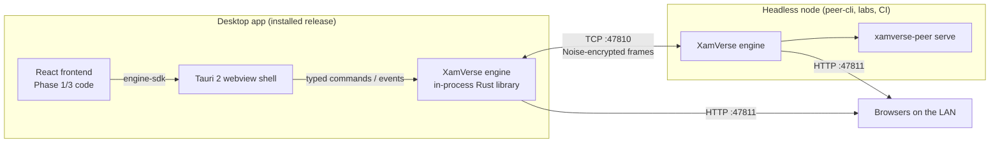
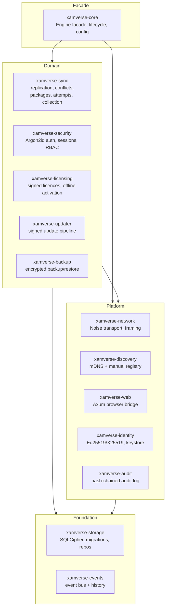
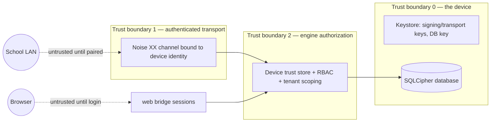

# XamVerse Phase 2 — Engine Architecture

Status: implemented on branch `feat/desktopz` (baseline: `feat/phase1-handoff`).
Scope reminder: Phase 2 delivers the **desktop infrastructure engine** — not the
educational application. Phase 3 builds business features on top of the
contracts described here and in `ENGINE_API.md`.

---

## 1. Prime directive: every node is autonomous

There is **no permanently designated master, collector, admin or server
computer**. Every XamVerse installation runs the same engine binary with the
same capabilities:

| Capability | Where implemented |
|---|---|
| Own encrypted local database | `xamverse-storage` |
| Own cryptographic device identity | `xamverse-identity` |
| Accept *and* initiate peer connections | `xamverse-network` |
| Serve authenticated local APIs (desktop + browser) | `xamverse-web` |
| Discover peers / manual IP connect / pair / revoke | `xamverse-discovery`, `xamverse-network`, `xamverse-storage` (trust store) |
| Send and receive replicated records | `xamverse-sync` |
| Durable sync queue surviving restarts | `xamverse-sync` (outbox persisted in SQLite) |
| Result collection by *any* authorized administrator | `xamverse-sync::collection` |
| Serve the browser app over LAN | `xamverse-web` |

Privilege comes from **authenticated users and signed authorization events**,
never from which machine a person happens to use. An administrator may
temporarily *coordinate* an operation (e.g. distribute an assessment) but this
grants their computer no permanent role.

## 2. Process model



* **Tauri shell** (`src-tauri/`) embeds the engine as a library. The React UI
  talks to the engine only through `@xamverse/engine-sdk` adapters, so the same
  frontend runs in the webview *and* in a LAN browser.
* **`xamverse-peer` CLI** runs the identical engine headless. This keeps the
  engine testable without the GUI and gives Phase 3 a scriptable reference node.
* The engine never requires a running Next.js server. The production frontend
  is a static bundle served by `xamverse-web` (browser mode) or the Tauri
  asset resolver (desktop mode).

## 3. Crate decomposition



Dependency rules (enforced by review, cheap to keep true):

1. `xamverse-events` and `xamverse-storage` depend on nothing internal.
2. Domain crates never depend on `xamverse-core` or `xamverse-web` (no cycles).
3. All persistence goes through `xamverse-storage` repositories — no raw SQL
   outside that crate, no SQL string building from user input anywhere.

## 4. Trust boundaries



Concretely:

* Knowing an IP address authorizes **nothing**. Every frame arrives inside an
  encrypted channel whose remote static key was verified during the Noise XX
  handshake and whose device card signature was checked.
* Peer-level operations additionally require the remote device to be
  **paired and trusted** (per school) and not revoked. Revocation is enforced
  at connect time and per operation.
* User-level operations (web bridge, local API) require a session and an
  engine-side permission check (`xamverse-security`). Frontend checks are
  convenience only.
* Records carry `school_id`; the apply pipeline rejects cross-school payloads
  before they touch tenant tables. The engine, not the UI, is the tenant
  firewall.
* A browser session can never obtain device private keys, Tauri commands or
  peer-privileged operations; the web bridge exposes a narrow, permission-
  checked REST/SSE surface only.

## 5. Wire protocol (summary)

Versioned JSON envelopes inside a Noise-encrypted, length-prefixed TCP stream
(default port **47810**, the Phase 1 prototype port). Full specification:
`docs/phase2/P2P_PROTOCOL.md`.

```text
Handshake:  Noise XX (snow crate) — authenticates both static X25519 keys
Identity:   DeviceCard { device_id, name, protocol_version, signing_pk,
                      signature over (handshake_hash || device_id || signing_pk) }
            -> proves the peer owns the Ed25519 identity it claims
Frames:     u32 BE length + JSON { v, id, kind, payload }   (cap: 32 MiB)
Messages:   hello / ping / manifest_request / manifest / ops_push / ops_ack
            / blob_get / blob_chunk / error / goodbye
```

Protocol version is exchanged in `hello` and in every `DeviceCard`; mismatching
majors refuse the connection. Message kinds are additive — unknown kinds yield
a structured `error` frame, never a silent no-op.

## 6. Replication model (summary)

Full specification: `SYNC_ENGINE.md` and `CONFLICT_RESOLUTION.md`.

* Changes are **operations** (`SyncOp`) with ULID-ordered `op_id`, per-object
  monotonic `revision`, the `base_revision` they were created against, a
  Lamport clock for causal ordering (wall clocks are never authoritative), the
  author device and an **Ed25519 signature over the canonical op**.
* Receivers apply ops through a fixed pipeline: transport identity → device
  trust → tenant check → signature → category/schema validation → idempotency
  (`op_id`) → CAS conflict detection → transactional commit → durable
  **receipt**. Bytes-on-the-wire is never success; only a stored ack is.
* Retries use the durable outbox with exponential backoff + jitter; transfers
  carry checkpoints so resumed sends re-send only what is missing.
* Payloads > 256 KiB ride as content-addressed blobs (SHA-256) with resumable
  chunked transfer.
* Conflict strategies are per-category policy (immutable, preserve-both,
  quarantine, manual) — **no unconditional last-write-wins anywhere**.
* No hardcoded collectors: collection is a pull initiated by whoever holds
  `sync.collect` authorization, targeting any reachable trusted peer.

## 7. Database (summary)

Single SQLCipher database per installation; every tenant row carries
`school_id` and every repository method takes the school scope explicitly.
Trade-offs and alternatives: `DATABASE.md`, ADR-0002, ADR-0005. Migrations are
transactional, checksum-verified and forward-only; the schema covers
installations, schools, users/credentials, roles/permissions, sessions,
devices/trust, sync ops/objects/jobs/checkpoints, blobs, packages, attempts
(hash-chained events), receipts, conflicts, licences, audit, updates, backups,
jobs and key-value engine state.

## 8. Identity & key hierarchy

```text
Device identity (per installation)
├── Ed25519 signing keypair      — signs ops, device cards, activation requests
├── X25519 static keypair        — Noise XX transport identity
└── fingerprint = "XV-" + base32(SHA-256(signing_pk || transport_pk))[..10]
                                     shown to humans during pairing
Database key (per installation)   — 32 random bytes, SQLCipher PRAGMA key
Issuer keys (offline, external)   — Ed25519; signs licences; public key pinned in app
Release keys (offline, external)  — Ed25519; signs update manifests; public key pinned
User credentials                  — Argon2id (OWASP params m=19456,t=2,p=1)
Session tokens                    — 32 random bytes, stored only as SHA-256 hashes
```

Private material never leaves the device, is never committed to Git, and the
desktop keystore prefers the OS keychain with a permissions-restricted file
fallback (documented residual risk in `SECURITY_MODEL.md`).

## 9. Failure & recovery posture

* WAL journaling + `synchronous=NORMAL` + transactional apply = crash-safe
  local writes; interrupted syncs resume from persisted checkpoints.
* Synchronization is **not** backup: `xamverse-backup` produces
  passphrase-encrypted, AEAD-authenticated archives with verified restore.
* Updates: signed manifests, platform/schema gating, downgrade refusal,
  exam-active interlock, backup-first, history retained. Irreversible
  migrations are never auto-rolled-back — documented staged recovery instead.
* Licence expiry **never destroys data**: restricted-access policy keeps
  read/backup/export alive.

## 10. Engineering invariants (applies to all Phase 2 code)

1. Readability first: small modules, explicit types, comments only where logic
   is non-obvious (each module states *why* it exists).
2. No magic values — constants live in one place per crate (`consts.rs` or
   `lib.rs`) with units in the name.
3. No hardcoded assumptions about devices, roles or network topology; policy
   lives in configuration and the database.
4. Performance: batched queries, prepared-statement reuse, bounded channels,
   WAL, no N+1 query patterns in hot paths.
5. Security: fail closed, deny by default, generic auth errors, constant-time
   verification via reviewed crates only.
6. Non-standard or risky choices are flagged in code (`// NOTE(non-standard):`)
   and in `KNOWN_LIMITATIONS.md`.
