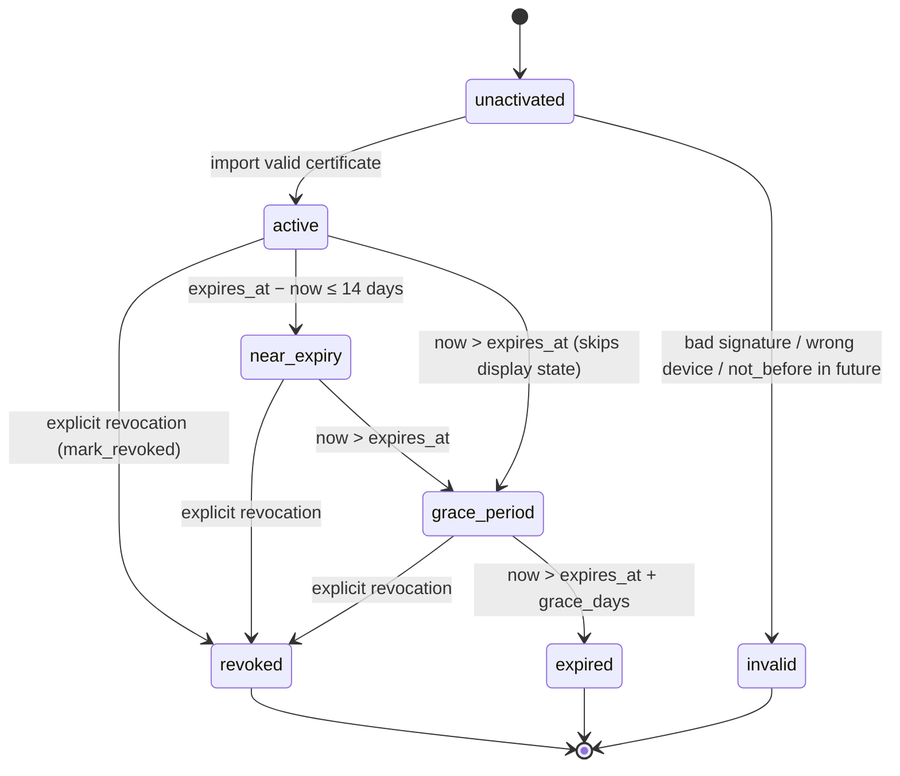

# Licensing — certificates, offline activation, state machine, restricted mode

This document specifies the licensing runtime: the signed certificate schema
(`crates/xamverse-licensing/src/cert.rs`), the separation between offline
issuers and in-app verification, the offline activation file flow (with a
Mermaid sequence diagram), the licence status state machine, restricted mode
entitlements, device binding as copy protection, and the offline limitations
(delayed revocation, clock rollback) that are documented rather than hidden.

---

## 1. What this covers and why it exists

Licences must work with **zero internet connectivity** (school reality,
spec §19), prevent casual copying, and never endanger exam data: expiry
degrades capability, it does not destroy or lock data. The design is the
same trust shape as updates: an offline issuer signs with Ed25519; the
engine only ever holds the issuer's **public** verification keys
(`LicenceConfig.trusted_issuer_pks`, injected by the desktop shell).

## 2. Certificate schema

```rust
pub struct LicenceCertificate {
    pub licence_id: String,
    pub school_id: String,
    pub plan: String,              // one of PLANS: "starter" | "standard" | "campus"
    pub features: Vec<String>,     // entitlement strings, e.g. "exams.create"
    pub device_id: String,         // device binding — the target installation
    pub device_fingerprint: String,// "XV-XXXX-XXXX-XXXX-XXXX" of that device
    pub device_limit: i64,         // seat allowance (enforced by Phase 3 onboarding)
    pub issued_at: String,         // RFC 3339
    pub not_before: String,
    pub expires_at: String,
    pub grace_days: u32,           // read-only grace window after expiry
    pub issuer_id: String,
    pub signature: String,         // base64 Ed25519 over the certificate sans this field
}
```

* Canonical signing form: serde JSON of the struct with `signature` excluded;
  struct field order is the canonical order (same convention as device cards
  and ops), so issuer and engine sign/verify identical bytes.
* Verification has two layers:
  * `verify_binding(pks, device_id, fingerprint)` — signature by a trusted
    issuer **and** device binding (plan must be known) — no clock involved.
  * `verify(...)` — binding + temporal window (`not_before`, `expires_at +
    grace_days`). Import refuses an already fully-expired certificate
    outright; a licence that expires *after* import degrades via the state
    machine instead.
* `binding_summary()` renders a short human-verifiable `LIC-XXXX…` derived
  from `device_id|expires_at` for the activation screen.

## 3. Issuer separation

```text
┌───────────────────────────── offline, external ───────────────────────────┐
│  Production issuer: Ed25519 private key on protected media/HSM.           │
│  Public key(s) injected into every desktop build via EngineConfig         │
│    → LicenceConfig.trusted_issuer_pks.                                    │
│  license-issuer-dev: DEVELOPMENT-ONLY issuer (test keys). Flagged in      │
│  code: the keypair file exists only because this is not production.       │
└───────────────────────────────────────────────────────────────────────────┘
```

* `tools/license-issuer-dev` can `generate-key` and `issue` against an
  activation request, so the whole offline flow is exercisable in dev/CI.
  It must never hold production keys (its module doc states the boundary).
* The engine rejects certificates from any unlisted issuer
  (`signature not from a trusted issuer`) — pinned by
  `untrusted_issuer_is_rejected`.

## 4. Offline activation flow

```mermaid
sequenceDiagram
    autonumber
    participant D as Unactivated device (engine)
    participant U as USB / paper hop
    participant I as Issuer (internet-connected, offline key)

    D->>D: ActivationRequest::create(identity, school_hint)
    Note over D: request = { device_id, device_fingerprint, device_name,<br/>school_hint, generated_at, device_public_key,<br/>device_signature (Ed25519 over canonical fields) }
    D->>U: activation request file (JSON)
    U->>I: carry the file
    I->>I: request.verify() — refuse unsigned requests
    I->>I: build LicenceCertificate bound to (device_id, fingerprint)
    I->>U: signed licence file
    U->>D: carry back
    D->>D: import_activation(cert_json)
    D->>D: verify(): issuer signature + device binding + window
    D->>D: persist licence row (raw cert + parsed fields, activation_mode)<br/>audit licence.activated; publish licence.status_changed
```

Properties worth noting:

* Fabricating an activation request is pointless — the resulting certificate
  binds to the *fabricator's* device, useless elsewhere (documented in
  `cert.rs`).
* Import is idempotent in shape (a renewal replaces the current row) and
  records `activation_mode` = `offline` or `renewal`.
* The engine's status is **computed**, never trusted from the stored row:
  `status()` re-parses the raw certificate and re-verifies binding, so a
  tampered stored row simply computes `Invalid`.

CLI shape (dev/ops surface):

```bash
xamverse-peer --data-dir <dir> licence-request --out activation-request.json --school "School"
license-issuer-dev generate-key --out issuer-keypair.json
license-issuer-dev issue --request activation-request.json --key issuer-keypair.json \
    --plan standard --days 365 --grace 30 --device-limit 5 --out licence.json
xamverse-peer --data-dir <dir> licence-import --file licence.json \
    --issuer-pk "$(python3 -c 'import json;print(json.load(open("issuer-keypair.json"))["public_key_b64"])')"
```

The request file is the shared `ActivationRequestFile` envelope
(`{"request": {…}}`) from the `xamverse-licensing` crate — one type written
by `licence-request` and read by the issuer, so the on-disk shape cannot
drift between tools (it did once; fixed and verified end-to-end with the
debug binaries through `status: Active`). `licence-import` requires
`--issuer-pk` (repeatable for rotation); keys are validated up front
(base64, 32 bytes) so a typo fails with an actionable message. The engine
still enforces trust at verification time — the flag only configures
`EngineConfig.trusted_issuer_pks` for that invocation, mirroring how the
desktop shell will inject the production issuer key.

## 5. State machine

Mirrors Phase 1 `STATE_MACHINES.md` §9:



Implementation details:

* Status is **derived at query time** from the raw certificate + clock
  (`status()`), except the persisted `revoked` flag which `effective_status()`
  respects on top.
* `NEAR_EXPIRY_DAYS = 14`; persisted DB status stores `active` for
  near-expiry (it is a display state, not a stored one) — the DB CHECK allows
  the full enum regardless.
* Every transition visible to the user publishes
  `EventKind::LicenceStatusChanged` (SSE/Tauri event
  `licence.status_changed`).
* `display_summary()` returns licence id, plan, status, expiry, device limit
  and a masked product key (`XV-XX-****` — never the signature).

## 6. Entitlements and restricted mode

```rust
pub const RESTRICTED_MODE_FEATURES: &[&str] =
    &["data.read", "data.export", "backup.create", "backup.restore"];
```

`entitlements()` by status:

| Status | Entitlements available |
|---|---|
| `active`, `near_expiry` | the certificate's feature list |
| `grace_period` | certificate features ∩ `RESTRICTED_MODE_FEATURES` |
| `expired`, `revoked`, `invalid` | exactly `RESTRICTED_MODE_FEATURES` |
| `unactivated` | none |

Design intent (spec §19, enforced by this mapping): expiry **never** destroys
data or blocks recovery — read, export and backup/restore stay alive so a
school can always leave with its data or recover after paying. Everything
else (exam authoring, new activations, …) requires `active`. Phase 3 gates
its business features by consulting `feature_available(feature)`; the engine
does not interpret non-reserved feature strings.

## 7. Device binding / copy protection

* The certificate carries `device_id` + `device_fingerprint`; import and
  every status computation verify both against the local identity
  (`verify_binding`). Copying `licence.json` to a second installation fails
  with `LicenceError::DeviceMismatch` — pinned by
  `licence_copying_to_another_device_fails`.
* The fingerprint binds to **both** device keypairs
  (`SHA-256(signing_pk | transport_pk)`), so reinstalling the app without
  wiping the keystore keeps the identity (renewal), while moving the disk to
  other hardware keeps working only if the keystore moves too — the binding
  is cryptographic identity, not hardware serials (documented trade-off; no
  driver-level hardware locking).
* `device_limit` is recorded for Phase 3 seat enforcement during onboarding;
  the engine stores and surfaces it but does not count seats.

## 8. Offline limitations (documented, not hidden)

1. **Delayed revocation.** Revocation (`mark_revoked`) is applied when the
   engine learns of it (event replicated like any op or entered manually);
   a device that never hears about it remains in its last known state until
   sync. Same class as the offline revocation gap in `SECURITY_MODEL.md`
   (ADR-0006).
2. **Clock rollback.** Status derives from the local clock; an operator with
   OS access can rewind it to keep a licence in `active`. The window is
   bounded by `not_before` for premature activation and by the update
   pipeline's semver gate for binaries, but licence *expiry* is not
   rollback-proof. Future mitigation candidates: monotonic counters, signed
   time envelopes from any online contact.
3. **No online activation endpoint in Phase 2.** The flow is the file
   round-trip; an online activation service would reuse
   `ActivationRequest`/`LicenceCertificate` unchanged.
4. **Renewal requires a fresh certificate** — there is no in-place licence
   mutation; the new cert's `device_id` binding must match the same
   installation.
