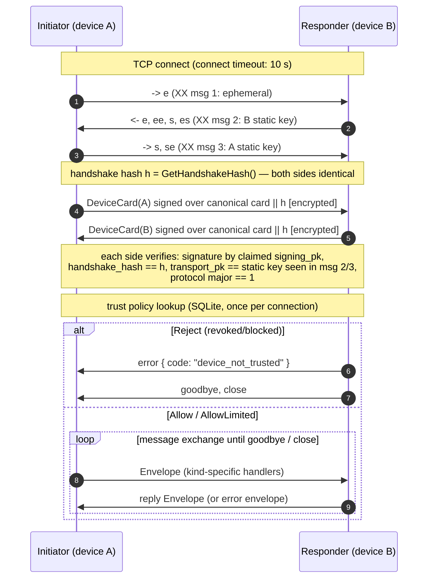

# P2P Protocol — transport, handshake, frames and message catalogue

This document specifies the peer-to-peer wire protocol spoken by XamVerse
engines on TCP port 47810: the Noise XX handshake with device-card binding,
the length-prefixed frame format, every message kind with its payload fields
(read from `crates/xamverse-network/src/framing.rs` and
`crates/xamverse-sync/src/messages.rs`), version compatibility rules, the
trust decisions taken at connect time, and the structured-error behaviour for
unknown or unauthorized message kinds.

---

## 1. Layering

```text
TCP socket (default :47810, xamverse_network::DEFAULT_PEER_PORT)
  └─ Noise transport   "Noise_XX_25519_ChaChaPoly_BLAKE2s"  (snow crate)
       └─ framing      u32 BE length + one Noise ciphertext per frame
            └─ envelope  JSON { v, id, kind, payload }  (≤ 65_519 bytes)
                 └─ sync/service payloads (typed serde structs)
```

Design rationale is ADR-0003: Noise XX mutually authenticates both static
X25519 keys with no PKI and no certificate expiry — device identity *is* the
key — and versioned JSON frames stay debuggable with the peer CLI and
consistent with the TypeScript-facing HTTP/JSON API. Large content never
inflates frames; it rides the content-addressed blob sidecar protocol
(§5.6).

## 2. Handshake sequence

Every connection — regardless of direction — runs the same three-message XX
handshake followed by an encrypted device-card exchange. Both sides finish as
equals; there are no fixed client/server roles (either node may initiate an
assessment push or a result collection).



What makes this strong (all of it is tested):

* **Mutual authentication without PKI** — XX authenticates both static keys
  in the handshake itself.
* **Card ↔ handshake binding** — `DeviceCard::sign(identity,
  Some(handshake_hash))` and verification against the live channel's hash.
  A captured card cannot be replayed on another connection
  (`card_roundtrip_verifies`: wrong binding and binding-outside-handshake
  both fail; constant-time comparison).
* **Identity/transport ownership** — the card's `transport_pk` must equal the
  remote static key observed in the handshake
  (`IdentityTransportMismatch` otherwise). Test: a responder presenting a
  card signed by a third identity is refused by the initiator.
* **No wall-clock dependence** — transport security never expires; version
  compatibility is the only gate (§6).

Key code surfaces:

```rust
// crates/xamverse-network/src/secure.rs
pub const NOISE_PARAMS: &str = "Noise_XX_25519_ChaChaPoly_BLAKE2s";
pub async fn handshake(mut stream: S, role: HandshakeRole, transport_secret: [u8; 32])
    -> Result<(Self, String /* remote static, base64 */), ChannelError>;
pub async fn exchange_device_cards(&mut self, identity: &DeviceIdentity,
    expected_transport_pk_b64: &str) -> Result<AuthenticatedPeer, ChannelError>;
```

## 3. Frame format

```text
offset  size  field
0       4     ciphertext_len (u32, big-endian)
4       n     ciphertext (one Noise transport message, n ≤ 65_535)
```

* One frame == one Noise message == one JSON envelope. Noise caps a message
  at 65_535 bytes including the 16-byte Poly1305 tag, hence the application
  payload cap:

```rust
pub const MAX_APP_PAYLOAD: usize = 65_519;      // 65_535 − 16
pub const MAX_BLOB_CHUNK: usize = 60_000;       // headroom for base64 + JSON
pub const MAX_CIPHERTEXT_FRAME: usize = 65_535 + 4;
```

* `read_noise_frame` rejects announced lengths above `MAX_CIPHERTEXT_FRAME`
  before allocating (`FrameError::Oversized`) — defence in depth against a
  hostile peer, on top of the Noise ceiling itself.
* `send_msg` refuses to serialize a payload above `MAX_APP_PAYLOAD`
  (`FrameError::PayloadTooLarge`) — the caller must use blob chunking.
* A `goodbye` envelope is the graceful close; a plain TCP close is also
  normal (logged at debug, expected in a school lab).

## 4. Envelope

```rust
// crates/xamverse-network/src/framing.rs
pub struct Envelope {
    pub v: u32,          // PROTOCOL_VERSION_MAJOR (currently 1)
    pub id: String,      // uuid v7 — correlates responses, aids tracing
    pub kind: String,    // message kind (§5)
    pub payload: serde_json::Value,  // typed at the sync/service layer
}
```

Every error reply references its cause, so clients can correlate failures:

```json
{ "v": 1, "id": "018f...", "kind": "error",
  "payload": {
    "code": "unknown_kind",
    "detail": "this node does not implement that message",
    "in_reply_to": "018f-...-request-id",
    "received_kind": "future_kind" } }
```

## 5. Message catalogue

Kinds `hello`, `ping`, `pong`, `error`, `goodbye` live in the network crate;
all sync kinds live in `xamverse-sync`. Payload structs are quoted verbatim
from `crates/xamverse-sync/src/messages.rs`.

### 5.1 Session / diagnostics

| Kind | Direction | Payload | Authorization |
|---|---|---|---|
| `hello` | — | reserved by framing kinds; version exchange is performed by the DeviceCard | — |
| `ping` | any → any | `Ping { sent_at: String }` | open to every authenticated device |
| `pong` | reply | `Pong { sent_at, responded_at }` | reply |
| `error` | reply | `ErrorPayload { code, detail, in_reply_to? }` | reply |
| `goodbye` | any | `{}` | graceful close |

### 5.2 Pairing

| Kind | Direction | Payload | Authorization |
|---|---|---|---|
| `pair_request` | requester → responder | `PairRequest { school_id, school_name, requester_device_id, requester_name, requester_fingerprint }` | **open to every authenticated device** — this is how trust begins |
| `pair_pending` | responder → requester | `PairPending { responder_device_id, responder_name, responder_fingerprint }` | reply |

Semantics: the responder upserts the requester's device row (fingerprint
**recomputed** from the verified card's keys, never client-claimed), records
`device_trust.state = 'pending'`, audits `devices.pair_requested`, and
publishes a `device.paired` event (device field `"pending"`) for the
approval UI. It never records `trusted` on its own. The requester mirrors the
responder as `pending` locally. An authorized user then approves
(`SyncEngine::approve_pairing`, audited `devices.paired`), which flips the
state to `trusted`.

### 5.3 Manifest (pull)

| Kind | Direction | Payload | Authorization |
|---|---|---|---|
| `manifest_request` | receiver → sender | `ManifestRequest { school_id, categories: Vec<String>, since_lamport, limit }` | trusted (`Allow`) |
| `manifest` | sender → receiver | `Manifest { school_id, summaries: Vec<ObjectSummary>, max_lamport, truncated }` | reply |

`ObjectSummary` (from the storage repos): `{ category, object_id, revision,
op_id, payload_sha256, tombstone, lamport }`. An empty `categories` list
means "all categories the receiver is enrolled for"; the sender pages at
`MANIFEST_PAGE = 500` summaries per reply and sets `truncated` when more
remain. The sender refuses schools it is not enrolled for
(`school_not_enrolled`).

### 5.4 Operations

| Kind | Direction | Payload | Authorization |
|---|---|---|---|
| `ops_get` | receiver → sender | `OpsGet { school_id, op_ids: Vec<String> }` | trusted |
| `ops` | sender → receiver | `OpsReply { school_id, ops: Vec<SyncOpWire> }` | reply; filtered to the requested school |
| `ops_push` | sender → receiver | `OpsPush { school_id, ops: Vec<SyncOpWire> }` | trusted |
| `ops_ack` | receiver → sender | `OpsAck { receipts: Vec<OpReceipt> }` | reply |

`SyncOpWire` (canonical signing form; serde struct order is the canonical
order — both sides sign identical bytes):

```json
{
  "op_id": "018f…",  "school_id": "s1",  "category": "question_bank",
  "object_id": "q-1", "revision": 2,    "base_revision": 1,
  "author_device_id": "018e…",         "lamport": 42,
  "tombstone": false,                  "schema_version": 1,
  "payload_sha256": "<hex>",
  "payload_json": "{…}",               // optional (inline, ≤ 256 KiB)
  "blob_sha256": "<hex>",              // optional (content-addressed)
  "signature": "<base64 Ed25519>"
}
```

`OpReceipt { op_id, outcome }` where outcome is `applied`, `duplicate`,
`conflict { conflict_id }` or `rejected { reason }`. A push of blob-backed
ops may first receive `rejected { reason: "blob_required:<sha>" }`; the
sender then streams the blob (§5.6) and re-pushes (bounded at
`MAX_BLOB_ROUNDS = 16` negotiation rounds).

### 5.5 Blob transfer

| Kind | Direction | Payload | Authorization |
|---|---|---|---|
| `blob_status` | sender → receiver | `BlobStatus { sha256 }` | pending **or** trusted |
| `blob_status` | reply | `BlobStatusReply { sha256, stored_bytes, total_size }` | reply (`total_size = 0` until first chunk) |
| `blob_put` | sender → receiver | `BlobChunk { sha256, offset, total_size, data_b64, eof }` | pending **or** trusted |
| `blob_status` | receiver ack | `BlobStatusReply { sha256, stored_bytes, total_size }` | reply |

Sequential-append protocol: `offset` must equal the receiver's stored length
or the chunk is refused (`Constraint`). On completion (`stored ==
total_size`) the receiver hash-verifies the assembled content; a mismatch
**deletes** the partial blob so the next status poll restarts from zero.
`blob_put`/`blob_status` being open to `AllowLimited` (pending) devices is
deliberate: pairing-adjacent flows and resumable content negotiation need
them, and every write is content-hash-checked before commit.

### 5.6 Deprecated/renamed kinds

`ops` (reply to `ops_get`) and the two `blob_status` roles are distinct
message kinds on the wire, discriminated by direction; the handler matches on
kind plus trust decision, not on a request id.

## 6. Version compatibility

```rust
// crates/xamverse-identity/src/card.rs
pub const PROTOCOL_VERSION_MAJOR: u32 = 1;
pub const PROTOCOL_VERSION_MINOR: u32 = 0;
impl ProtocolVersion {
    pub fn is_compatible_with(&self, other: &Self) -> bool { self.major == other.major }
}
```

* The version rides in **every** `Envelope.v` and in **every** DeviceCard;
  the card check is authoritative during `exchange_device_cards`.
* **Major mismatch → refuse the connection**
  (`ChannelError::ProtocolMismatch`); there is no negotiation or fallback —
  a school upgrades its fleet.
* **Minor differences interoperate** — minors are additive (new optional
  fields, new message kinds).
* New message kinds are always additive: an older node answers
  `unknown_kind` (§7) instead of crashing, so a mixed-version LAN degrades
  gracefully rather than breaking.

## 7. Trust decisions and unknown kinds

The engine installs one trust policy (`SyncEngine::trust_policy`, shared
logic in `Engine::start`), evaluated once per connection against the pairing
store:

| `device_trust.state` (any enrolled school) | TrustDecision | Effect |
|---|---|---|
| `trusted` | `Allow` | full message surface |
| `pending` | `AllowLimited` | `pair_request`, `ping`, `blob_put`, `blob_status` only |
| `revoked` / `blocked` | `Reject` | connection refused: structured `device_not_trusted` error then close (server side); client aborts |
| unknown device | `AllowLimited` | pairing handshake reachable; nothing else |

Handler authorization per kind is fixed in `crates/xamverse-sync/src/handler.rs`:

* `pair_request`, `ping` — open to all authenticated devices.
* `blob_put`, `blob_status` — open to `Allow | AllowLimited`.
* **Everything else — `Allow` only.** Pending or unknown devices receive the
  structured error `"device is not fully trusted; complete pairing first"`;
  partial data is never leaked.
* **Unknown kinds → structured error, never a silent no-op** (spec §12):
  `error { code: "unknown_kind", in_reply_to, received_kind }`. The same
  policy applies to malformed payloads (`request_failed` with the
  deserialization error) and protocol errors, which close the connection.

Success on the wire is still meaningless by itself: an op is only "delivered"
when its durable receipt says `Applied` or `Duplicate` — see
`SYNC_ENGINE.md` §"What success means".
