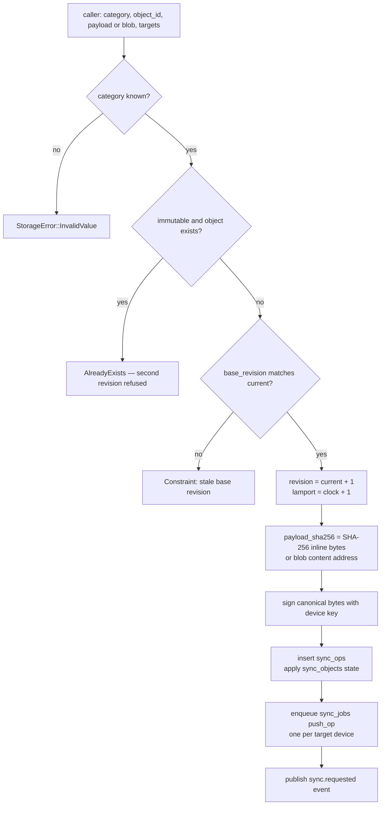
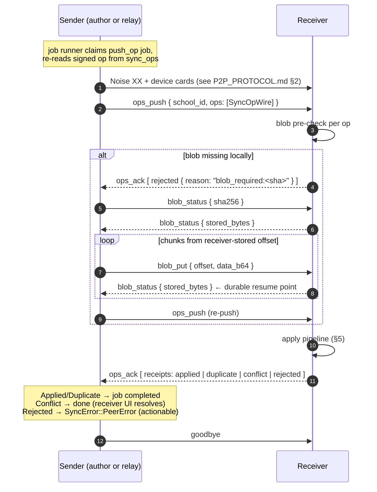

# Sync Engine — replication, durable outbox, transfers and receipts

This document explains how data actually moves between XamVerse nodes: the
operation model (ADR-0004), how a local change becomes a signed op plus
durable outbox jobs, the push and pull flows (with Mermaid diagrams), retry
backoff, resumable blob transfer, checkpoints and manifest diffing,
per-category replication policies, and the engine's definition of success
(durable receipts, never bytes on the wire). Source of truth:
`crates/xamverse-sync/src/{local,runner,engine,apply,handler,store}.rs`.

---

## 1. Operation model

Every replicated change is a **`SyncOp`**, not a table snapshot:

```rust
pub struct SyncOpWire {
    pub op_id: String,            // uuid v7, ULID-ordered
    pub school_id: String,        // tenant — checked before anything else
    pub category: String,         // registry key with a per-category policy
    pub object_id: String,        // logical record id
    pub revision: i64,            // per-object monotonic counter (CAS)
    pub base_revision: i64,       // revision the author saw (0 = create)
    pub author_device_id: String,
    pub lamport: i64,             // causal order; wall clocks never decide
    pub tombstone: bool,
    pub schema_version: i64,      // currently 1
    pub payload_sha256: String,   // inline payload hash, or blob address
    pub payload_json: Option<String>,  // inline payloads ≤ MAX_INLINE_PAYLOAD (256 KiB)
    pub blob_sha256: Option<String>,   // large payloads ride the blob protocol
    pub signature: String,        // Ed25519 by the author device
}
```

The canonical signing form is the serde JSON of the struct with the signature
excluded; field order is fixed, so both sides sign and verify identical bytes
without a canonicalization pass. `verify_payload_hash` covers inline bytes,
or the blob's content address for blob-only ops (both may be present — e.g.
package manifest inline + content blob).

Categories and their policies live in one registry
(`category.rs`, ~21 entries — the union of the Phase 1 prototype's 12 payload
types and the Phase 2 spec §12 categories, so nothing the prototype
simulates is silently rejected):

| Policy | Categories (examples) | Effect |
|---|---|---|
| `restricted` | `device_identity`, `identity_records`, `role_permissions`, `permissions`, `staff_records`, `student_records` | only from paired **and** trusted senders; default conflict strategy `Quarantine` |
| `immutable` | `assessment_package`, `exam_attempt`, `submission` | only revision 1 is ever accepted; default strategy `Reject` |
| `standard` | `question_bank`, `assessment_revision`, `approval_request/decision/event`, `exam_attempt_event`, `result_set`, `result_revision`, `school_settings`, `audit_event`, `backup_metadata`, `update_package`, `conflict_resolution` | normal CAS pipeline; default strategy `Manual` |

Unknown categories are quarantined as `schema_unsupported` conflicts — never
applied, never silently dropped. `RESULT_CATEGORIES = [exam_attempt,
submission, result_set]` defines what collection pulls by default.

## 2. Writing locally: `LocalOps::create`

All local writes that must replicate go through one function, which does
everything in **one transaction** (no half-created ops):



The Lamport clock is kept in `kv` as `lamport.<school_id>` and advanced
inside the same transaction. On the receive side the clock also jumps forward
when a remote op carries a higher value (`max(local, seen) + 1` on the next
local write path via `advance_lamport`). Wall-clock timestamps are recorded
for humans (`received_at`, `updated_at`) but **never** participate in
conflict decisions — see `CONFLICT_RESOLUTION.md`.

## 3. Durable outbox and the job runner

`sync_jobs` is the outbox (schema in `DATABASE.md` §6). `spawn_job_runner`
polls every **500 ms** (`JOB_POLL_INTERVAL`), claims up to 8 due jobs per
pass (`JobsRepo::due` on `status, next_attempt_at`), marks them `running`
(a persisted state transition — crash-safe), executes and marks `completed`.

Failure handling (`runner.rs`):

```rust
pub(crate) const RETRY_BASE: Duration = Duration::from_secs(2);
pub(crate) const RETRY_CAP: Duration = Duration::from_secs(300);   // 5 min
pub(crate) const MAX_RETRIES: i64 = 8;

pub fn backoff(attempt: i64) -> Duration {
    // base * 2^attempt, capped at 5 min, ±25% jitter, floor 100 ms
}
```

* attempts 1..7 → `record_failure` sets `next_attempt_at = now + backoff`
  and publishes `sync.paused { reason: "retry in …" }`.
* attempt 8 → job becomes `failed` with the last error appended
  (`"(retries exhausted)"`) and publishes `sync.failed`.
* `Engine::init` requeues jobs a crash left in `running`
  (`requeue_interrupted_jobs`), so an interrupted transfer self-heals on
  restart.
* Outbound concurrency: `with_peer_connection` serializes connections per
  target through a semaphore (`Semaphore::new(1)` per device id) — a
  100-node lab must not open 100 simultaneous sockets per node. The address
  comes from `kv["peer.addr.<device_id>"]` (learned from every successful
  connection) or an explicit override.

## 4. Push flow



Blob negotiation is bounded (`MAX_BLOB_ROUNDS = 16`) and the sender verifies
its own copy's hash **before** claiming it is the content
(`BlobHashMismatch` otherwise). Progress events (`sync.progress`,
`done/total`) are emitted per 256 KiB.

## 5. The apply pipeline (receiver side)

Fixed order, from `apply.rs` — every incoming op produces exactly one
receipt:

| # | Gate | Failure outcome |
|---|---|---|
| 0 | op's `school_id` must match the batch's tenant | `Rejected { school_mismatch }` |
| 1 | **Tenant gate** — school enrolled locally | `Rejected { school_not_enrolled }` |
| 2 | **Category gate** — category in registry | conflict `schema_unsupported` (quarantined) |
| 3 | **Restriction gate** — restricted category requires `sender.trusted == true` | conflict `unauthorized_restricted_payload` + `security.alert` event |
| 4 | **Signature gate** — author device known locally + signature verifies | `Rejected { unknown_author: … }` / `Rejected { invalid_signature }` + security alert |
| 5 | **Payload hash** matches the signed claim | `Rejected { payload_hash_mismatch }` |
| 6 | **Idempotency** — `op_id` already in log | `Duplicate` (lost-ack retry safety) |
| 7 | **CAS analysis** (inside the tx): revision ≤ current → same hash ⇒ `Duplicate`; same revision different hash ⇒ conflict `divergent_revision`; older ⇒ `Rejected { stale_revision }`. Immutable categories with `current > 0` ⇒ conflict `immutable_violation`. Tombstone flip ⇒ conflict `update_vs_delete`. Non-immutable with stale `base_revision` ⇒ conflict `concurrent_update` (or `Rejected` when the category's strategy is `Reject`) | conflict row per category policy |
| 8 | **Transactional commit** — op log + object state + Lamport advance in one tx | `Applied` |

Receipts are then mapped to typed events: `package.received`,
`submission.received`, `sync.completed`, `conflict.detected`,
`sync.failed`, `security.alert` — the UI surface (see `ENGINE_API.md`).

The transport peer (who sent the batch) is distinct from the op author
(`SenderContext`): a relay forwards ops signed by their original author, so
signature verification uses the author's known key while the restriction gate
uses the transport trust decision.

## 6. Pull flow (manifest diff + checkpoints)

Pull is how collectors gather results and how nodes catch up after being
offline. `execute_pull` runs for both `pull` and `collect` job kinds
(collection is a pull scoped to `RESULT_CATEGORIES`).

```mermaid
sequenceDiagram
    autonumber
    participant P as Puller (this node)
    participant Q as Remote peer

    P->>Q: Noise XX + cards; trust policy on Q decides
    loop pages until empty or !truncated (guard: 1000 pages)
        P->>P: checkpoint = max(sync_checkpoints[peer][cat…])
        P->>Q: manifest_request { school_id, categories, since_lamport, limit: 500 }
        Q->>P: manifest { summaries, max_lamport, truncated }
        P->>P: diff — keep summaries where local current_revision < summary.revision
        P->>Q: ops_get { op_ids: [wanted] }
        Q->>P: ops { ops: [SyncOpWire] }
        P->>Q: blob_get/stream for missing blob-backed ops (resumable)
        P->>P: apply pipeline → receipts (rejects abort the pull)
        P->>P: record collection receipts for RESULT_CATEGORIES ops
        P->>P: advance checkpoints[peer][cat] = manifest.max_lamport
    end
    P->>Q: goodbye
```

Checkpoint keys are `(school_id, peer_device_id, category)` with `'*'` as the
all-categories watermark. They advance only after a page's ops are applied,
so a crash loses nothing — the next pull re-fetches from the stored
watermark. The manifest page size (500) keeps every envelope well under the
65_519-byte frame cap; `PullSummary { applied, duplicates, conflicts }` feeds
logs and the collection dashboard (`"pull complete received=N …"`).

**Collection receipts**: for every applied op in `RESULT_CATEGORIES` that is
not a tombstone, the puller writes a `collection_receipts` row
(`UNIQUE(attempt_id, collector_device_id)` — idempotent per collector). This
is the durable "a finalized attempt reached collector X" proof used by the
results workflow in Phase 3.

## 7. Blob transfer with resume

* Content is addressed by SHA-256; the `blobs` table stores `(sha256, size,
  data)`. Senders chunk at `MAX_BLOB_CHUNK = 60_000` bytes (base64 in JSON,
  still under the 65_519 Noise cap).
* The receiver's stored length **is** the resume checkpoint: `blob_status`
  asks "how many bytes do you have?", and each `blob_put` ack returns the new
  stored length. An interrupted transfer resumes exactly there — no
  side-files, no re-scan.
* Append discipline: `offset != stored_length` is a `Constraint` error; size
  can never exceed `total_size`.
* On completion the receiver re-hashes; a mismatch deletes the partial blob
  (next status poll restarts from zero) and the sender's job retries with
  backoff. Corrupted transfer therefore cannot be committed under a correct
  address.

## 8. Replication policies (who gets what, when)

* **Push targets are caller-controlled**: `LocalOps::create` takes
  `target_device_ids` and enqueues one job per target. "Send to all trusted
  peers" is a higher-layer helper (core/Phase 3), not hardcoded policy —
  no topology assumptions in the engine.
* **Collection is a pull, by any authorized administrator** — no hardcoded
  collectors. Whoever holds `sync.collect` (RBAC) enqueues `collect` jobs
  targeting any reachable trusted peer.
* **Finalized attempts** replicate as one immutable `exam_attempt` op whose
  payload is the `AttemptEnvelope` (attempt metadata + full event chain) —
  the receiver gets the evidence, not just the score.
* **Packages** import as an inline manifest op + content-addressed blob;
  receivers must obtain the blob before the op will apply (`blob_required:`
  negotiation), so a package can never be half-present.

## 9. What "success" means

Spec §12's criterion, implemented in `runner.rs`:

> An op is **sent** only when its receipt says `Applied` or `Duplicate`.
> Bytes on the wire never count.

Concretely:

| Outcome | Meaning | Sender-side effect |
|---|---|---|
| `Applied` | op is committed in the receiver's log + object state, durable in the receiver's SQLite | push job completes |
| `Duplicate` | receiver already had this `op_id` (or identical revision content) | push job completes — retry after a lost ack is free |
| `Conflict { conflict_id }` | receiver quarantined the op as data; **its** UI resolves it | push job completes; nothing more to do here |
| `Rejected { reason }` | actionable failure (`unknown_author`, `stale_revision`, `blob_required` before streaming, …) | surfaces as `SyncError::PeerError`; job retries/backs off |

Everything is idempotent: re-pushing an applied op yields `Duplicate`;
re-pulling yields the same via the manifest diff (local revision is not
older). Restarting mid-transfer resumes blobs at the receiver's offset and
jobs at their persisted status. This is what makes "blocked transfers
auto-resume on peer reconnection" (Phase 1 handoff §1.4) true by
construction.
