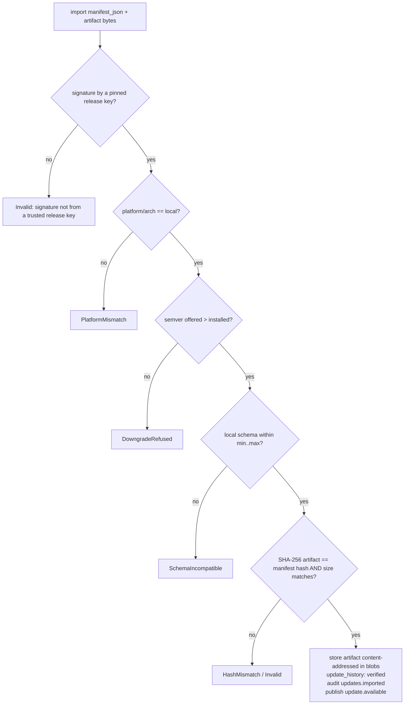

# Updates and Installers — manifests, verification pipeline, interlocks, packaging

This document covers the verified update pipeline (`crates/xamverse-updater`):
the release manifest schema, the verification pipeline every device runs on
import, offline import and LAN redistribution via the content-addressed blob
store, staging with safety interlocks, and the installer layout for the
Tauri 2 desktop shell — including the code-signing steps that are
**required before commercial release and deliberately not fabricated in this
environment**.

---

## 1. Trust model

Release manifests are **Ed25519-signed** by release keys whose public halves
are pinned in configuration (`EngineConfig.trusted_release_pks` — the
desktop shell injects the production key, tests inject a dev key). Private
keys never ship with the app. Every receiving device re-verifies
independently, which is what makes USB sneakernet and LAN relay distribution
**equally safe** — there is no "trusted distributor" node.

## 2. Manifest schema

```rust
pub struct ReleaseManifest {
    pub version: String,          // semver; downgrades refused
    pub platform: String,         // windows | macos | linux
    pub arch: String,             // x86_64 | aarch64
    pub min_schema: i64,          // engine schema compatibility window
    pub max_schema: i64,
    pub artifact_sha256: String,  // SHA-256 of the covered artifact
    pub artifact_size: u64,
    pub notes: String,
    pub release_key_id: String,
    pub signature: String,        // base64 Ed25519 over the manifest sans this field
}
```

Canonical signing form: serde JSON of the struct with `signature` excluded;
struct field order is the canonical order (same convention as device cards,
ops and licences).

## 3. Verification pipeline (`UpdaterService::import`)

The pipeline runs on **every** import, from USB or LAN, in this exact order —
each step fails closed with a typed `UpdateError`:



Notable details:

* Downgrade refusal is **semver**, not string comparison
  (`Version::parse` both sides; `offered <= current` refused).
* The schema window is what makes engine upgrades planable: a manifest
  declares which database schema versions it can migrate from/to; the engine
  refuses anything outside its window (`SchemaIncompatible { min, max,
  local }`).
* Import is idempotent on artifact hash (the blob store deduplicates;
  history keeps every state transition).

## 4. Staging, interlocks and apply

```rust
pub struct UpdateInterlocks {
    pub pre_apply_check: Arc<dyn Fn() -> Result<(), String> + Send + Sync>,  // exam-active interlock
    pub pre_apply_backup: Arc<dyn Fn() -> Result<(), String> + Send + Sync>, // backup-first
}
```

`stage(update_id)`:

1. Runs **both interlocks first** — before touching anything. The exam
   interlock (wired by Phase 3 to live exam-session state) blocks staging
   while an exam is in progress (spec §24: do not interrupt active
   examinations); the backup hook produces a `xamverse-backup` archive
   first.
2. Writes the artifact to `staging_dir/xamverse-update.bin`.
3. **Re-verifies what it just wrote** (SHA-256 against `update_id`) — the
   comment in code calls it paranoia; for exam integrity it is policy.
4. Marks `staged` in history.

`mark_applied` / `mark_rejected` close the lifecycle; the actual binary swap
belongs to the **Tauri shell** (it owns the running executable). History
states: `imported → verified → staged → applied` plus `failed` and
`rejected`, all queryable via `history(limit)` and visible in the UI's
update centre.

**No automatic rollback.** Irreversible database migrations are never
auto-rolled-back (DATABASE.md §4); recovery from a bad apply is
restore-from-backup using the interlock-produced archive, or forward-fix
with a corrective release.

## 5. Offline import + LAN distribution

* **Offline import (USB):** the school receives `manifest.json` +
  artifact on media; `import()` runs the §3 pipeline locally. No internet,
  no server.
* **LAN redistribution:** because verified artifacts live content-addressed
  in the engine's `blobs` table, a device that imported an update can serve
  it to peers; the receiving devices run the identical verification pipeline
  on whatever bytes arrive. Trust never derives from *who* sent the bytes —
  only from the pinned release signature and the hash.
* Distribution to specific peers rides the normal sync job machinery
  (`update_package` is a registered sync category), and the Phase 3 update
  centre models this exactly like assessment distribution (the Phase 1
  prototype's `distributeUpdate` contract maps here).

## 6. Installer layout (Tauri 2 shell)

```text
src-tauri/                     (independent cargo package — excluded from the
                                workspace; needs GUI system libraries absent on
                                headless build machines, ADR-0001)
├── src/                       Rust shell: embeds xamverse-core as a library
│   └── commands               Tauri commands map 1:1 to engine subsystems
│                              (auth, permissions, peers, sync, conflicts,
│                               packages, attempts, licensing, updates,
│                               backups, audit, diagnostics, events)
├── capabilities/              Tauri 2 capability files (IPC allowlists)
├── icons/                     bundled icons
└── tauri.conf.json            bundler config → .msi (Windows) / .dmg (macOS)
```

* The shell embeds the **same** `Engine` struct the CLI runs — one code path
  for desktop and headless (ADR-0001; the behavioral-identity requirement
  behind Tests A–J).
* The React frontend from Phase 1/3 is embedded; it talks to the engine only
  through `@xamverse/engine-sdk` adapters (desktop IPC adapter via Tauri
  invoke), so the same UI runs in the webview and in a LAN browser
  (`BROWSER_ACCESS.md`).
* `tauri bundler` produces the installers: `.msi` (WiX) for Windows,
  `.dmg`/`.app` for macOS. CI jobs (not present in this sandbox — see
  `KNOWN_LIMITATIONS.md`) build and bundle these per-platform; the engine
  workspace itself never depends on GUI libraries.
* Installer responsibilities beyond copying files: tighten the data
  directory's Windows ACLs for the keystore (documented in
  `keystore.rs`), register firewall rules for TCP 47810/47811 (Phase 1
  handoff §6.4), optionally trust-onboard the bridge TLS certificate
  (`BROWSER_ACCESS.md` §6), and seed `EngineConfig` with the production
  issuer/release public keys.

## 7. Code signing — required steps before commercial release

Nothing below is fabricated as "done"; it is the documented checklist the
release engineers must complete. The update pipeline's cryptographic
verification is independent of installer signing, but OS trust requires both.

**Windows (.msi)**

1. Acquire an EV/OV code-signing certificate (HSM- or token-backed).
2. Sign the bundled engine executables and the `.msi` with `signtool sign
   /fd sha256 /tr <RFC3161 TSA> /td sha256 …` (timestamping so signatures
   survive certificate expiry).
3. Verify with `signtool verify /pa /v`.
4. Record the signing cert fingerprint in release engineering docs; the
   update manifest's `release_key_id` is the *engine-level* key and separate
   from the OS-level cert.

**macOS (.dmg/.app)**

1. Enroll in the Apple Developer Program; obtain a Developer ID Application
   certificate.
2. `codesign --deep --force --options runtime --sign "Developer ID
   Application: …" XamVerse.app` (hardened runtime required for notarization).
3. Notarize: `xcrun notarytool submit XamVerse.dmg --wait`, then
   `xcrun stapler staple XamVerse.dmg`.
4. Verify: `spctl -a -vv -t exec XamVerse.app`.

**Release keys (engine-level)**

1. Generate the Ed25519 release key offline; store on protected media/HSM.
2. Pin the **public** key in production `EngineConfig.trusted_release_pks`
   (and the licence issuer key in `trusted_issuer_pks`).
3. Sign every `ReleaseManifest` with the offline key at release time.
4. Publish the public key fingerprint in the product's verification docs so
   schools can confirm what their builds pin.

**Key custody rules** (mirroring `LICENSING.md` §3): private keys never on
build machines, never in Git; a compromised release key is a fleet-wide
trust failure (`SECURITY_MODEL.md` §4.13).
